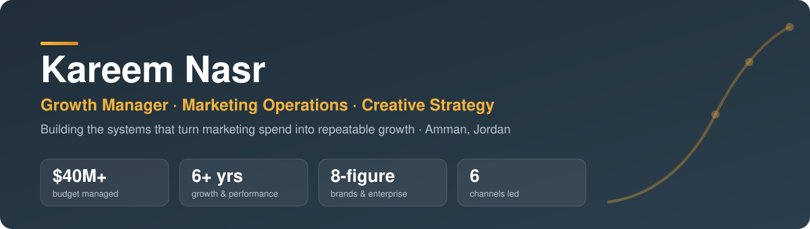
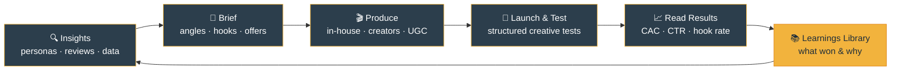
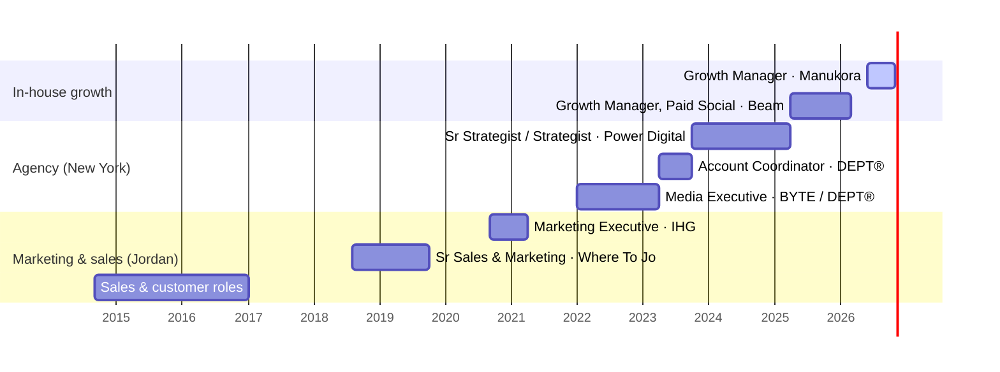

  

  
  
  

> **Most brands don't have a channel problem. They have a thinking problem.**
> Weak briefs, leaky funnels, and teams built to spend rather than learn. I build the operating systems, rituals and teams that fix that.

---

## 🚀 Now: Growth Manager @ Manukora

<table>
<tr>
<td width="55%" valign="top">

**Premium wellness DTC brand · `Jun 2026 – Present` · Remote**

I run the growth function day to day. That means owning the creative engine, managing the channel leads, and building the marketing-ops layer that holds them together.

- 🎯 **Lead the acquisition mix** across Meta, Search, YouTube, CTV, podcasts and creators
- 🧑‍🤝‍🧑 **Manage the channel leads** and act as "creative quarterback" between strategy, production and media buying
- 📊 **Own exec reporting**, with a weekly CEO update and monthly performance reviews
- ⚙️ **Built the marketing operating system** of rituals, trackers and automations (below)
- 🧪 **Run the test roadmap**, including landing-page A/B tests, top-of-funnel launches and tracking/pixel tests

</td>
<td width="45%" valign="top">

**Channels I lead**

| | Channel | Role |
|:-:|---|---|
| 📱 | Meta | Core acquisition |
| 🔎 | Search | Capture demand |
| ▶️ | YouTube | Scale & awareness |
| 📺 | CTV | Upper funnel |
| 🎙️ | Podcasts | Sponsorships |
| 🤳 | Creators / UGC | Content & whitelisting |

</td>
</tr>
</table>

### 🔁 The growth operating system I run

### 🗓️ Operating cadence

| Cadence | Ritual | Purpose |
|---|---|---|
| ☀️ **Daily** | Desk triage & CAC tracker | Catch issues before they cost money |
| 📅 **Weekly** | Creative sync · Creative production call · Acquisition pod · Partnerships pod | Align strategy, production and media |
| 📅 **Weekly** | Automated creative results pull | Every ad scored and logged with its key learning |
| 📨 **Weekly** | CEO update | One clear view of performance, risks and asks |
| 📆 **Bi-weekly** | Performance review | Channel and creative deep-dive |
| 🗂️ **Monthly** | Creative retro & next month's scripts | Win rate by angle, format and talent, fed into new briefs |

### 🛠️ Marketing ops systems I've built

| System | What it does |
|---|---|
| 🧠 **Creative OS (Notion)** | Pipeline from brief to launch to results, with a learnings library behind it |
| 🤖 **AI-automated reporting** | Weekly pulls from ad analytics into Notion, with auto-drafted pre-reads and exec updates |
| 🤝 **Creator sourcing & whitelisting workflow** | Standardised creator requests, briefs and tracking with the partnerships team |
| 📉 **Daily acquisition-cost tracker** | Daily Meta and blended CAC visibility for faster decisions |
| 🗃️ **Creative asset management** | Proposal to move creative storage from Drive to a CMS/DAM |
| 👥 **Persona research program** | Customer data used to steer audiences and creative angles |

---

## 📈 Career path

### 💼 Experience

<b>Beam — Growth Manager, Paid Social</b> · <code>Apr 2025 – Mar 2026</code> · New York

- Owned paid social growth strategy, budget and creative direction for a DTC brand.

<b>Power Digital Marketing — Senior Strategist / Strategist, Paid Social</b> · <code>Oct 2023 – Apr 2025</code> · New York

- 🏢 **Tesla, HEYDUDE, Rubio's** and more · 💰 about **$15M in annual media** on Meta and X
- Built and ran the **creative testing program**, turning test insights into creative direction
- Ran account operations and client relationships, and coached junior strategists · ⬆️ *promoted after 10 months*

<b>DEPT® — Digital Marketing Account Coordinator</b> · <code>Apr 2023 – Oct 2023</code> · New York

- 🏀 **Golden State Warriors, California Credit Union** · 💰 **$7M a year** across Meta, TikTok and LinkedIn
- Planning, resourcing and cross-functional delivery

<b>BYTE / DEPT® — Media Executive, Paid Social</b> · <code>Jan 2022 – Apr 2023</code> · New York

- 📰 **Gannett (USA Today)** and others · 💰 **$10M a year** across Meta, TikTok, Reddit and Twitter via Smartly.io

<b>IHG Hotels & Resorts — Marketing Executive</b> · <code>Sep 2020 – Apr 2021</code> · Aqaba

- Monthly promotions, quarterly budget allocation, brand content and third-party distribution

<b>Where To Jo — Senior Sales & Marketing Executive</b> · <code>Aug 2018 – Oct 2019</code> · Amman

- Brand, social and influencer marketing plus B2B partnerships · joined as an intern and was offered a full-time role

<b>Earlier: sales & customer leadership</b> · <code>2014 – 2017</code>

- Trainers Gym (Membership Sales) · I 24 connect (Telesales Team Leader) · Crystel.co (Customer Service)

---

## 🧰 Toolkit

**Leadership & ops**

**Marketing**

**Platforms & tools**

---

## 🎓 Education & languages

| 🎓 | | 🌍 | |
|---|---|---|---|
| **University of Jordan** | B.A. Marketing · 2014–2019 | **English** | Native |
| **SAE Institute** | Assoc. Multimedia Design & Digital Marketing · 2020 | **Arabic** | Native |

Open to senior marketing, growth and marketing-ops roles: Head of Growth · Marketing Director · Head of Marketing Operations

